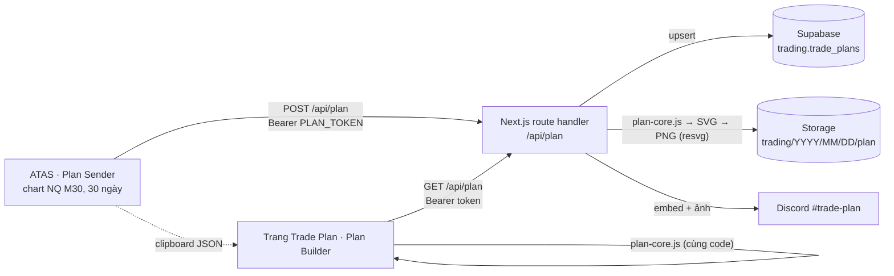

# 02 · Kiến trúc hiện tại

Từ 2026-11-18 repo là **monorepo pnpm**: `apps/web` (Next.js trên Vercel), `supabase/` (migration), sau này `packages/*`. Trang học vẫn là HTML tĩnh, đặt trong `apps/web/public/`; Next.js phục vụ chúng qua rewrites và chạy API. Stack đích: [07](07-chuyen-doi-web-app.md), quyết định D26–D31 ở [06](06-quyet-dinh.md).

## Stack
| Lớp | Công nghệ | Ghi chú |
|---|---|---|
| App | Next.js 16 (App Router) + TypeScript, Node.js 26 trên Vercel (`sin1`) | `apps/web`; pnpm workspaces |
| Trang học | HTML tĩnh + CSS + vanilla JS trong `apps/web/public/` | Mỗi trang tự nạp script bằng `<script src="...?v=N">`; URL sạch nhờ rewrites trong `next.config.ts`, cache `/assets/*` 1 giờ |
| API | Route handler `apps/web/app/api/plan/route.ts` | `@resvg/resvg-js` 2.6.2 (SVG → PNG); plan-core nạp qua `apps/web/lib/plan-core.ts` |
| Migration | Supabase CLI, thư mục `supabase/` | `config.toml` expose schema `trading` |
| Database | Supabase Postgres, gọi qua PostgREST bằng `fetch` | Không dùng `supabase-js` |
| File | Supabase Storage, bucket private `trading` (`YYYY/MM/DD/plan|journal/`) | URL ký tạm 1 giờ |
| Thông báo | Discord webhook (multipart: `payload_json` + ảnh) | Không phải bot |
| Nguồn dữ liệu | Indicator ATAS C# `Deren · Plan Sender` | Gửi JSON lúc 9:29 ET |
| i18n | Python script sinh trang EN từ trang VI | `i18n/build_en.py` |

## Sơ đồ luồng plan


## Cấu trúc thư mục
```
package.json, pnpm-workspace.yaml   Gốc monorepo (pnpm 10): script dev / build / check / i18n
apps/web/                           Next.js — Vercel Root Directory
  next.config.ts                    rewrites URL sạch (/levels → levels.html), redirect .html, /testing, /overlap; header cache + bảo mật
  vercel.json                       framework nextjs, regions ["sin1"]
  app/api/plan/route.ts             API plan: lưu / đọc plan, vẽ ảnh, gửi Discord (hợp đồng giữ như api/plan.js cũ)
  lib/plan-core.ts                  Cầu nối kiểu TS tới public/assets/js/plan-core.js (tạm, trước khi port sang packages/plan-core)
  fonts/                            Be Vietnam Pro (đã ghép glyph DejaVu), JetBrains Mono, cho resvg
  public/                           Site tĩnh cũ:
    index.html / index.en.html      Tổng quan (dashboard học)
    levels.html / .en               Khoá TPO Level (9 chương)
    tools.html / .en                Khoá Orderflow Tools (9 chương)
    plan.html / .en                 Trade Plan · Composite × pRTH × OVN (7 chương) · system chính
    quiz.html / .en                 Trung tâm trắc nghiệm
    manifest.webmanifest            PWA manifest (icon 192/512)
    assets/css/app.css              Design system, shell, quiz engine
    assets/css/{tools,levels,ema,tape,plan}.css   Style theo trang (scope .pg-*)
    assets/js/core.js               Shell: sidebar, topbar, bottom nav, router chương, đồng hồ phiên, nút VI/EN; window.OFS
    assets/js/quiz.js               Quiz engine: luyện tập, thi thử, ôn câu sai
    assets/js/bank-*.js             Ngân hàng câu hỏi (tools, levels, ema)
    assets/js/fp.js                 Renderer footprint kiểu ATAS, helper DOM / tape, 13 kịch bản
    assets/js/tools-page.js, tape-pats.js   Widget khoá Tools
    assets/js/levels-data.js, levels-page.js, ema-page.js   Dữ liệu + widget khoá Level
    assets/js/plan-core.js          Engine plan thuần (UMD): dùng chung trình duyệt + server
    assets/js/plan-page.js          UI trang Trade Plan (khoá localStorage giữ tên cũ ofs.tp.*)
    assets/js/en/                   Bản EN sinh tự động của các file JS trên (không sửa tay)
    assets/sample_plan_20261112.json  Payload mẫu để test API
supabase/                           config.toml, migrations/ (khớp lịch sử migration trên production), seed.sql
docs/plan-sender/                   PlanSender.cs, prompt build, supabase.sql (bản gộp để đọc), hướng dẫn
i18n/                               build_en.py, extract.py (đọc/ghi apps/web/public), en.tsv, en_extra.tsv, keys.tsv
claude/                             Bộ nhớ dự án + prompts/
artifact/                           Nguồn artifact claude.ai: index.html, app.src.js, va_lines.txt → app.js
CLAUDE.md, .claude/                 Quy tắc + hook / agent / lệnh cho Claude Code
scripts/check-plan-core.mjs         Kiểm hồi quy plan-core với scripts/plan-core.snapshot.json
scripts/build-artifact.mjs          Ghép plan-core.js + artifact/app.src.js → artifact/app.js
```
Chỉ `apps/web` được build lên Vercel; các thư mục còn lại không deploy.

## Script mỗi trang nạp
Mọi trang đều nạp `core.js`, `quiz.js`, `fp.js`, `bank-tools.js`, `bank-levels.js`, `bank-ema.js` (quiz nhanh ở cuối chương dùng chung ngân hàng). Thêm theo trang:

| Trang | Script riêng |
|---|---|
| index | `home.js` |
| levels | `levels-data.js`, `levels-page.js`, `ema-page.js` |
| tools | `tools-page.js`, `tape-pats.js` |
| plan | `plan-core.js`, `plan-page.js` |

Phiên bản cache hiện tại: phần lớn `?v=18`, `core.js?v=20`, `levels-page.js?v=19`, `plan-core.js?v=3`, `plan-page.js?v=25`, `plan.css?v=21`.

## Shell và router (core.js)
- Mảng `NAV` khai báo trang, nhãn, màu, icon và danh sách chương `[slug, số, tiêu đề]`. Thêm trang / chương: sửa ở đây.
- Router chương dùng hash (`#ema`, `#builder`...). Chương đang xem lưu vào `ofs.last` để trang chủ có nút "Tiếp tục học".
- Đồng hồ phiên: giờ VN, đếm ngược tới RTH 9:30 ET và cửa sổ trade 9:30–11:30 ET, tự xử lý giờ mùa hè / đông của Mỹ.
- `window.OFS = {store, NAV, session, dur, clock, toast, svg, mini, LANG}` cho các script trang dùng chung.

## i18n
- Trang VI: `x.html`, JS ở `apps/web/public/assets/js/`. Trang EN: `x.en.html`, JS ở `apps/web/public/assets/js/en/`.
- `python3 i18n/build_en.py` dịch theo bảng `i18n/en.tsv` + `i18n/en_extra.tsv`, báo câu VI chưa có bản dịch.
- Khoá `ofs.lang` nhớ lựa chọn; trang VI tự chuyển sang EN nếu khoá là `en` (thêm `?stay` để chặn).
- Ảnh plan do server vẽ luôn là tiếng Việt.

## Nhánh và deploy
| Nhánh | Vai trò | Vercel | Supabase |
|---|---|---|---|
| `production` | Code đang chạy thật. Chỉ nhận merge từ `development` qua Pull Request | Production (`orderflow-trading-system.vercel.app`) | Project Singapore `gpbypxuglcfmvarmferr` |
| `development` | Nhánh làm việc hằng ngày, nhánh mặc định trên GitHub | Preview (URL nhánh cố định) | Hiện chưa có biến môi trường Preview → `/api/plan` trả 500; sau này trỏ project dev riêng |
| `feat/<việc>` (tuỳ chọn) | Việc lớn, tách từ `development`, merge lại qua PR | Preview riêng | như `development` |

- Quy trình: làm trên `development` (hoặc `feat/*`) → kiểm preview → PR `development` → `production` → Vercel deploy production.
- Vercel: Root Directory `apps/web`, framework Next.js, cài bằng pnpm (tự nhận `pnpm-lock.yaml` ở gốc repo), Node 26 (`engines` trong `apps/web/package.json`).
- Function `/api/plan`: `maxDuration 30`, region `sin1`, font gói kèm qua `outputFileTracingIncludes`; `@resvg/resvg-js` để ngoài bundle (`serverExternalPackages`).
- Redirect `/testing`, `/overlap` (và bản `.en`) → `/plan`; `/x.html` → `/x` (308).
- Schema database chỉ đổi qua `supabase/migrations/` (D30).

## Giới hạn của kiến trúc hiện tại
- Không có đăng nhập; trạng thái nằm ở `localStorage` nên mỗi thiết bị một kiểu, phải sao lưu tay.
- Không có component / template: shell dựng bằng JS, nội dung HTML lặp giữa VI và EN (sinh tự động).
- Một token chung `PLAN_TOKEN` cho API; token nằm trong `localStorage` của trình duyệt chủ site.
- Test tự động mới có snapshot engine plan (`scripts/check-plan-core.mjs`) và `next build`; giao diện kiểm bằng Playwright thủ công, API bằng JSON mẫu (local có thể dùng server Supabase giả).
